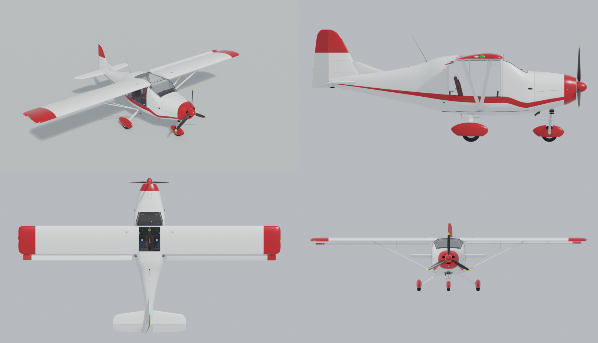

# Aero A240 for Microsoft Flight Simulator 2024

A simple community aircraft modelled on the Aero A240 (the tricycle-gear Aero
EuroFox): two seats, strut-braced folding high wing, full-span flaperons and a 100 hp
Rotax 912 ULS.

It is a native MSFS 2024 ("modular") aircraft, built with the SDK's package tool. The 3D
model lives in `blender\A240.blend` and is exported with the SDK's Blender exporter.



## Status

| Part | State |
| --- | --- |
| SDK package build | Builds with no problems reported by the SDK builder |
| 3D model (exterior + cockpit) | Detailed Blender model (~83k triangles), exported and checked in the viewer. **Not yet built with the SDK or seen in the sim** - the earlier low-detail model was |
| Flight / engine / systems configs | Written from published A240 figures. Engine, controls and hands-off pitch stability **checked in the sim**; performance not yet tuned |
| Cockpit display (EFIS) | Works in the sim with live data (airspeed, altitude and heading checked against the sim), and in a browser with demo data |
| Sound | **None yet** - the aircraft is silent (see below) |
| In-simulator test | Engine run-up and basic handling at 80-100 kt tested; flaps, stalls, takeoff and landing **not yet** |

## Build

Needs the MSFS 2024 SDK and Blender 5.2 (see [SDK_TOOLS.md](SDK_TOOLS.md)). Close the
simulator first.

```
powershell -ExecutionPolicy Bypass -File tools\build_sdk.ps1
```

This exports the models from `blender\A240.blend`, then runs the SDK package tool, which
starts the simulator in build mode for about half a minute. The result is
`sdk-project\Packages\local-aircraft-a240`. Add `-SkipModel` to rebuild after a config
change only, `-Rebuild` to ignore the build cache, or `-Previews` to re-render the
preview images and preset thumbnails too. If Blender is not in
`C:\Program Files\Blender Foundation\Blender 5.2`, set `$env:BLENDER` to its `blender.exe`.

## Edit the model

Open `blender\A240.blend` in Blender 5.2 and edit it like any model. To see and change
the MSFS material settings in Blender, enable the SDK's exporter once (Edit > Preferences >
File Paths > Script Directories > add `C:\MSFS 2024 SDK\Tools\Blender`, then enable
"Microsoft Flight Simulator 2024: glTF Extension"). The build scripts load the exporter
from the SDK themselves, so they work without that step.

To export just the models (and optionally previews) without the SDK build:

```
"C:\Program Files\Blender Foundation\Blender 5.2\blender.exe" -b blender\A240.blend --python-exit-code 1 --python tools\blender\export_a240.py -- --previews --cockpit
```

The export checks that the six control-surface animations, the `PROPELLER` /
`PROPELLER_Blur` nodes and the `EFIS_Display` screen material are all still there, and
fails if not. `--cockpit` also renders cockpit and close-up views into `previews\`.

Things the sim depends on - keep these names when editing:

- Collections `Exterior` (exported as `A240.gltf`) and `Interior` (`A240_interior.gltf`);
  the export presets point at them.
- `SKEL_Flap_L/R` (empties) with `SKEL_Aileron_L/R` under them, `SKEL_Elevator`,
  `SKEL_Rudder`, each with its `*_percent_key` action; keep their origins on the hinge line.
- `PROPELLER` (blades) and `PROPELLER_Blur` (disc), origins on the propeller axis. The
  spinner stays outside these, or it would vanish with the blades at high RPM.
- `EFIS_Screen` with material `EFIS_Display` (the HTML display is painted onto it, using
  its UVs).

`tools\blender\make_a240_blend.py` is the script that built the .blend from scratch. Once
you have edited the .blend by hand, do not re-run it - it overwrites the file.

## Install

```
powershell -ExecutionPolicy Bypass -File tools\install.ps1
```

This links the built package into the sim's Community folder. Restart the sim and pick
**Aero A240** (manufacturer *Aero*). Add `-Remove` to uninstall. Because it is a
link, later builds show up after a sim restart with no reinstall.

## Look at it without the sim

```
py -m http.server 8240 --bind 127.0.0.1
```

- <http://localhost:8240/viewer/index.html> - orbit the model, move the control surfaces,
  sit in the cockpit
- <http://localhost:8240/viewer/efis.html> - the cockpit display running on demo data

## Layout

```
sdk-project/                              the SDK project
  A240_Project.xml                        open this in the sim's Project Editor
  PackageDefinitions/local-aircraft-a240.xml
  PackageSources/
    SimObjects/Airplanes/Local_A240/
      common/config/                      aircraft, flight_model, engines, systems,
                                          cameras, cockpit .cfg
      common/model/                       exported glTF + behaviour XML (animations)
      common/panel/panel.cfg              puts the EFIS on the "EFIS_Display" surface
      common/effects/                     light effects (from the SDK sample)
      presets/local/A240/                 the selectable variant + thumbnails
    html_ui/.../LocalA240/EFIS/           the cockpit display (HTML canvas)
  Packages/                               build output (created by the build)
blender/
  A240.blend                              the 3D model (source)
tools/
  blender/export_a240.py                  .blend -> glTF, plus preview renders
  blender/make_a240_blend.py              built the .blend from scratch (don't re-run)
  blender/a240_lib.py                     shared helpers (coordinates, materials)
  build_sdk.ps1                           models + SDK package build
  legacy/build_model.py                   the old low-detail procedural model (reference)
  install.ps1                             links the build into Community
viewer/                                   browser previews
package/                                  the earlier hand-built package (see below)
```

`package/` is the first, hand-assembled version in the older single-folder layout. It is
no longer updated by the tools and can be deleted; it is kept only as a fallback.

## Coordinates

One origin is used everywhere: on the centreline, at the wing quarter-chord, at
propeller height. The model is in metres, the `.cfg` files in feet
(`z` forward, `x` right, `y` up). In Blender the nose points along -Y and the left wing
along +X (Blender is Z-up), which the exporter turns back into the sim's frame. If you
move something in the model (wheels, wing, tail, lights), update the matching numbers in
`flight_model.cfg` / `systems.cfg`.

## Known gaps

- **No sound.** MSFS 2024 does not support borrowing another aircraft's sounds in a
  native aircraft. The A240 needs its own sound package, which means Audiokinetic Wwise
  and the SDK's sample Wwise project.
- **No textures.** Every surface is a flat colour.
- **Nothing in the cockpit is clickable.** Use keyboard or controller bindings (start the
  engine with Ctrl+E, or begin the flight on the runway).
- **Electrical system uses the simple MSFS 2020-style description** (`[ELECTRICAL]`
  `Major = 1`), not the newer modular one.
- **Not usable in Career mode yet** - that needs `targeted_specializations` in the
  preset's `aircraft.cfg` and the load/passenger setup that goes with it.

## Things to check on the first flight

These are the places where I had to estimate; each is a small edit followed by a rebuild.

- **Blank cockpit display** - the screen is the model material named `EFIS_Display`
  (`panel.cfg` `texture=`, `SCREEN_MATERIAL` in `tools/blender/a240_lib.py`). The display script
  uses the sim's older instrument base class.
- **Horizon rolls or pitches the wrong way** - flip the sign in `readSim()` in `EFIS.js`.
- **Propeller does not turn, or the blur disc never appears** - `prop_node.0` in
  `engines.cfg` and the `PROPELLER` / `PROPELLER_Blur` nodes.
- **Too fast / slow, climbs too well / badly** - `power_scalar` and `fixed_pitch_beta` in
  `engines.cfg`, `drag_coef_zero_lift` in `flight_model.cfg`. Targets: ~100 kt cruise,
  ~1000 fpm climb, stall ~43 kt clean and ~35 kt with full flap.
- **Pitch trim / stability feels off** - `htail_incidence` and `aero_center_lift`. In this sim a
  *higher* `htail_incidence` gives *more* nose-up trim; 1.0 trims near level at ~100 kt.
- **Too much power** - static full throttle gives ~134 ft-lb at ~5065 RPM, more than the 912's
  100 hp. Lower `power_scalar` in `engines.cfg` if climb and speed come out too strong.

### Lessons from the first in-sim flights

- The sim **silently ignores the whole `[AERODYNAMICS]` section** if any parameter the SDK marks
  as required is missing (here: `drag_coef_air_spoilers` and the five `pitch_moment_*_aoa_table`
  / `pitch_moment_pitch_alpha_table` entries). The result was no wing lift and dead elevator and
  ailerons. The CFG validator does not warn about it. Quick check: the `STALL ALPHA` and
  `ZERO LIFT ALPHA` SimVars read 0 when the section was dropped.
- `engine_mechanical_efficiency_table` defaults to `0:0`, which gives zero output torque: the
  engine fires, then winds down and stops.
- `flaps-position.N` needs all 8 values (angle, speed limit, drag, lift, area, camber, aft,
  incidence).
- The sim only reads config files when it starts. Reloading the aircraft or resetting the flight
  does not pick up edits; rebuild and restart the sim.
- The cockpit screen only refreshes when the HTML page changes; drawing into a `<canvas>` does
  not count. `EFIS.js` flips an invisible style value every repaint, without which the screen
  showed its first frame for the whole flight.
- Blended glass is lit in proportion to its alpha, so high-alpha glass turns milky white in
  direct sun. Keep glass alpha around 0.01-0.05 with a neutral colour, as the SDK's DA62 does.
- With developer mode on, the sim serves an inspector for its HTML pages at
  <http://127.0.0.1:19999> (the cockpit display is the `VCockpit...` page), with a live console.
- **Sits nose-high or sinks into the ground** - the `point.N` lines in `[CONTACT_POINTS]`.
- **Lights missing** - the `lightdef.N` lines in `systems.cfg`.

Control-surface directions follow the SDK's own DA62 sample, so those should be right.
